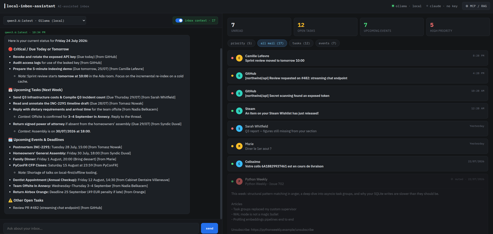
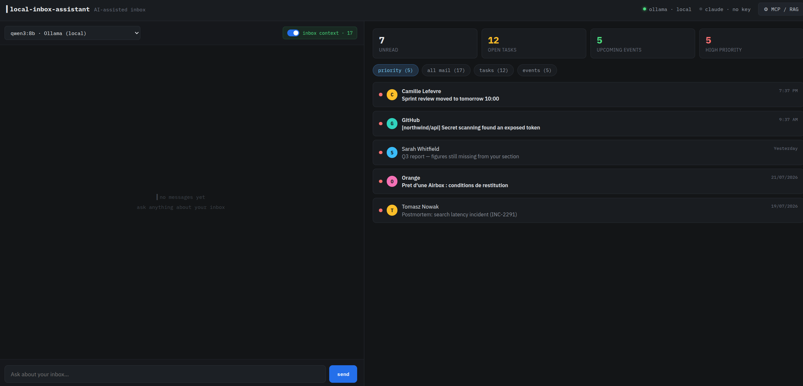
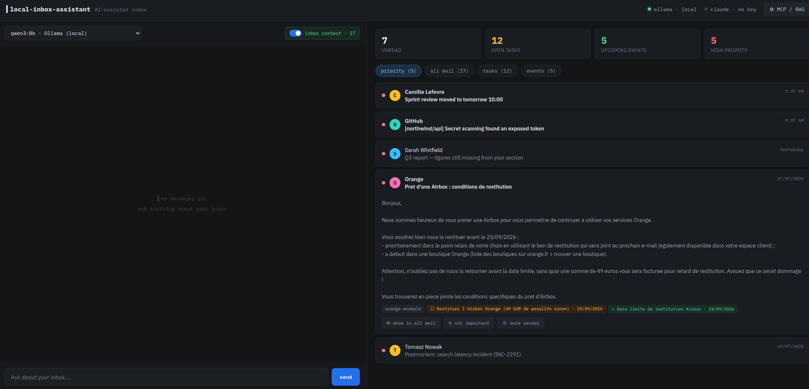
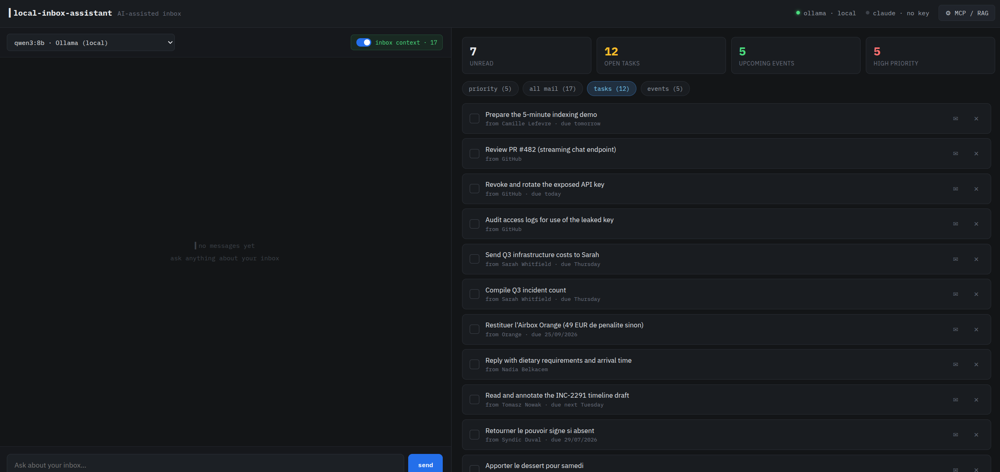
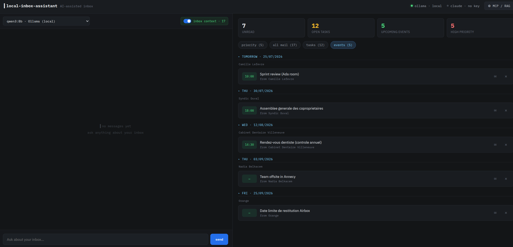

# local-inbox-assistant

[](https://github.com/elthommy/local-inbox-assistant/actions/workflows/tests.yml)

A fully local, AI-assisted inbox dashboard. It indexes every mailbox folder of
your Thunderbird profile (`.eml` files across all accounts), answers questions
about your mail with a local Ollama
model over a RAG index, extracts tasks / events / priority from recent emails,
and exposes the same data to other AI tools through an MCP server.

By default nothing leaves your machine: parsing, embeddings (ChromaDB +
`nomic-embed-text`), and chat all run locally. Optionally, chat can run on
Claude (Anthropic API) instead of the local model — an explicit opt-in per
conversation; see [Using Claude for chat](#using-claude-for-chat-optional).
Indexing, extraction, and embeddings always stay local.

## Demo

https://github.com/user-attachments/assets/6164f884-f007-4803-87e3-92f47c8853b0

*20 s, synthetic mailbox ([how it was made](docs/demo-scenario.md); no player?
[open the MP4](docs/media/demo.mp4)). In the video, priorities, tasks and events are the demo's canned
extraction results and chat answers are scripted; in real use a local model
produces both. Music: "Happy Beats / Business Moves Vol. 9" by Sascha Ende,
[ende.app](https://ende.app) ([CC BY 4.0](https://creativecommons.org/licenses/by/4.0/)).*

## Screenshots

All screenshots use the built-in synthetic mailbox, not real mail — see
[demo mode](#demo-mode-synthetic-mailbox) to reproduce them.

### Home Page / All Mail



*Chat with inbox context on: the answer is built from the RAG index over all
17 indexed emails, each item attributed to the message it came from. Answered
here by `qwen3.6`; the model is switchable from the dropdown.*

### Priority



*The priority filter: only mail the extraction pass flagged as high priority.*



*Expanding a message renders its body inline, with the extracted task and
deadline shown as chips underneath, plus per-sender mute and dismiss actions.*

### Tasks



*Every task the extraction pass found, across all mail, with its source and
due date. Checking one marks it done without leaving the dashboard.*

### Events



*Upcoming events grouped by day — French `dd/mm/yyyy` and English dates are
normalised into the same timeline.*


## Architecture

- **`backend/`** — Python (FastAPI, uv-managed, Python 3.12)
  - Maildir scanner + `.eml` parser (stdlib `email`, HTML→text fallback)
  - Incremental indexer: parse → embed (Ollama `nomic-embed-text` → ChromaDB)
    → LLM extraction of priority/tasks/events on recent mail
  - On-demand reading view: the email's HTML part converted to Markdown,
    with a quality heuristic that falls back to plain text (plus a
    "render anyway" override) when the conversion degrades — see
    [docs/ARCHITECTURE.md](docs/ARCHITECTURE.md#email-reading-view)
  - REST API + SSE streaming chat with RAG context
  - `mcp_server.py` — stdio MCP server (`search_mail`, `get_thread`,
    `list_tasks`, `list_events`)
- **`src/`** — React + Vite frontend (two-pane dashboard: chat + inbox)

Diagrams of the indexing pipeline and the chat/RAG flow are in
[docs/ARCHITECTURE.md](docs/ARCHITECTURE.md).

## Requirements

- [Ollama](https://ollama.com) running locally with:
  - an instruct model for chat and one for email parsing — defaults
    `qwen3:8b` (chat) and `gemma4:12b` (parsing), switchable in the UI; a
    missing one is offered for download by the app
  - `nomic-embed-text` for embeddings (`ollama pull nomic-embed-text`)
- [uv](https://docs.astral.sh/uv/) (manages Python 3.12 + deps)
- Node.js for the frontend
- A Thunderbird profile storing mail in **maildir** format (one `.eml` file
  per message) — auto-detected on Linux, otherwise set `INBOX_MAILDIR`
  ([where your mail is read from](#where-your-mail-is-read-from)); see also
  the mbox limitation below
- Optional: an Anthropic API key, if you want chat answers from Claude
  instead of the local model

### Limitation: maildir (`.eml`) only, no mbox

The indexer only reads maildir-style storage: one message per `.eml` file.
Thunderbird's **default** storage format, mbox (one big file per folder, no
extension), is **not supported** — folders stored as mbox are silently
invisible to the scanner. In Thunderbird, check **Account Settings → Server
Settings → Message Storage → Message Store Type**: it must say "File per
message (maildir)". The setting only applies to newly created accounts, so an
existing mbox account must be re-created (or synced into a maildir profile)
to be indexed. Other mail clients work too as long as they store one message
per `.eml` file under a common root.

### Where your mail is read from

`INBOX_MAILDIR` is the root scanned recursively for `.eml` files. Left unset,
it is auto-detected: the most recently modified `*.default-release` (or
`*.default`) profile under `~/.thunderbird`. To pin a specific profile — or to
index just one account or one folder — set it explicitly:

```bash
# backend/.env
INBOX_MAILDIR=~/.thunderbird/xxxxxxxx.default-release
```

Four things worth knowing:

- **Auto-detection is Linux-only.** It only looks under `~/.thunderbird`. On
  macOS (`~/Library/Thunderbird/Profiles`) and Windows
  (`%APPDATA%\Thunderbird\Profiles`) it never matches, so `INBOX_MAILDIR` has
  to be set by hand.
- **It belongs in `backend/.env`, not the root `.env`.**
  `INBOX_ANTHROPIC_API_KEY` is the exception that works in both places
  (`start.sh` exports that one specifically); every other `INBOX_*` variable
  is read only from `backend/.env` or the environment, and is silently
  ignored in the repo-root `.env`.
- **Changes need a backend restart.** Settings are read once at startup.
- **When detection finds nothing**, the path falls back to `~/.thunderbird`
  itself and indexing fails with `maildir root not found: …` — the fix is to
  set `INBOX_MAILDIR`. To check which path is actually in use, open **⚙ MCP /
  RAG → Data sources** in the app and hover the message count.

Which of the scanned folders end up indexed is a separate setting: see
[which folders are indexed](#which-folders-are-indexed).

## Run

```bash
./start.sh             # installs deps on first run, starts everything; Ctrl-C stops it
```

If Ollama is not running, the script tells you how to start it
(`sudo systemctl start ollama` or `ollama serve`) but leaves that to you;
pass `--start-ollama` to let the script launch `ollama serve` itself.

If Ollama is down *and* no Claude API key is configured
(`INBOX_ANTHROPIC_API_KEY`, in the environment, the root `.env`, or
`backend/.env`), the script exits with an error instead of starting servers
that have no inference backend to talk to. A key set in the root `.env` is
exported so the backend picks it up too.

By default the frontend is at http://localhost:5173 and the backend at :8000.
Ports are configurable via env vars or a `.env` file at the repo root (see
`.env.example`; env vars take precedence):

```bash
BACKEND_PORT=8080 FRONTEND_PORT=3000 ./start.sh
```

Or start the pieces manually:

```bash
# 1. backend (first start indexes the last 90 days of mail; watch progress in the UI)
cd backend
uv sync
uv run uvicorn app.main:app --port 8000

# 2. frontend
npm install
npm run dev            # http://localhost:5173 (proxies /api to :8000)
```

Backend configuration lives in `backend/.env` (see `backend/.env.example`):
mail root path, excluded folders, indexing window, model names, Ollama URL.

### Demo mode (synthetic mailbox)

To try the app — or take screenshots — without pointing it at real mail, seed a
self-contained demo mailbox of 27 invented emails (English and French, with
tasks, events and priorities already attached):

```bash
cd backend
uv run python -m scripts.seed_demo --reset
```

Everything lands in `backend/data/demo/` (or `--dir PATH`) and the real index
is never touched. The normal scan → parse → embed pipeline runs, so chat and
RAG work against the synthetic corpus; only the LLM extraction pass is
skipped, since the corpus ships its own canned results (fast and
reproducible). Dates in the corpus are relative to the seeding day, so it
never looks stale. Embedding needs Ollama running. The script prints the exact
command to launch the app against the demo data — it sets `INBOX_MAILDIR`,
`INBOX_DB_PATH` and `INBOX_CHROMA_PATH` so the demo and the real index stay
entirely separate.

Without Ollama (e.g. to record a video on another machine), seed with
`--skip-embed` and serve it with `uv run python -m scripts.demo_server`: chat
then answers a few scripted questions. See
[docs/demo-scenario.md](docs/demo-scenario.md).

### Changing models

Chat and email parsing (the task/event/priority extraction pass) use two
separate models, so a lighter model can triage the inbox while a bigger one
answers questions — or vice versa. Chat defaults to `qwen3:8b`, email parsing
to `gemma4:12b` (see [why](#why-gemma412b-for-parsing)); both are chosen in the
UI, from any non-embedding model pulled in Ollama (`ollama pull …`):

- **settings drawer → Models**: one dropdown for the chat model, one for the
  email parsing model, each option showing the model's size;
- **chat panel header**: the model dropdown there is the same chat-model
  setting, just closer at hand.

Choices persist (SQLite meta table) and survive restarts. A parsing model
switch only affects newly indexed mail — already-parsed emails keep their
cached results. To redo the current extraction window with the new model,
use the drawer's **"re-parse recent emails"** button.

**On a mixed-language mailbox, expect the chat model to drift into the wrong
language.** With French and English mail in the same index, `qwen3:8b` — the
default — will sometimes answer an English question in French, because the
retrieved excerpts it is reasoning over are French. The extraction pass is less
exposed to this: it runs once per email, so it only ever sees one language at a
time. Two ways out for chat, in increasing order of cost: state the language in
the question ("answer in English"), or switch the chat model to a larger one —
`qwen3.6` holds the requested language reliably here, at a much larger download
and more VRAM. This is a small-model limitation rather than a bug in the
retrieval, so it does not affect a single-language mailbox.

The embedding model is the exception: it is set via `INBOX_EMBED_MODEL` in
`backend/.env` (default `nomic-embed-text`), and changing it requires
rebuilding the RAG index (delete `backend/data/chroma/` and restart):
vectors from different embedding models are not comparable. There is
deliberately no reindex-from-scratch button in the UI — nothing tunable
there invalidates the embeddings.

**Missing models can be downloaded from the app.** When a configured model
(embedding, extraction, or the Ollama chat model) is not pulled, the app asks
whether to download it — downloads are several GB — and shows progress in the
status line ("downloading <model>…"). Until then indexing stops before
touching any email, so nothing is mis-extracted. `INBOX_AUTO_PULL` in
`backend/.env` changes this: `ask` (default) shows the prompt, `always` pulls
unattended (headless setups), `never` only reports the error naming the model
to `ollama pull`. Chat never pulls on its own; a missing chat model answers
with the same `ollama pull` hint.

### My priorities (personal triage rules)

The default priority rules are generic. **Settings drawer → My priorities**
takes your own rules in plain words, e.g. "votes on my crowdfunding
investments are high priority; their promotions stay low". They are appended
to the parsing prompt and may change only an email's priority, never its
tasks or events. The text is stored in the local SQLite meta table (never in
the code or the repo, never sent anywhere but the local Ollama model). Like a
model switch, it applies to newly parsed mail; after saving, the section
offers **"re-parse recent emails"** to apply it to the extraction window.

### Using Claude for chat (optional)

With an Anthropic API key configured (`INBOX_ANTHROPIC_API_KEY` in the
environment, the root `.env`, or `backend/.env`), the chat dropdown gains a
**Claude (cloud)** entry next to the local Ollama models. Selecting it routes
chat answers through the Anthropic API; the choice persists like any other
model choice, and switching back to a local model is one click.

What leaves the machine when Claude is selected: the chat conversation and
the context embedded in its prompt — the retrieved email excerpts, the
task/event lists, and the pinned email when using "summarize". Retrieval
(embeddings), indexing, and the task/event/priority extraction pass always
run locally, whichever chat backend is selected. Without a key, everything
is local and the Claude option stays disabled.

The Claude model defaults to `claude-opus-5` and can be overridden with
`INBOX_CLAUDE_MODEL` in `backend/.env`.

To compare candidate extraction models on your own mail before switching,
run the benchmark (read-only, compares against the stored results and writes
`backend/data/benchmark/summary.csv` + `disagreements.md`). Note that the
stored results are themselves a model's output, not ground truth — for a real
verdict, hand-check a sample (see below):

```bash
cd backend
uv run python -m scripts.benchmark_extraction --models qwen3:4b qwen3:8b
```

#### Why gemma4:12b for parsing

Measured on 280 hand-checked emails from a real, mostly French mailbox:
130 used to tune the extraction prompt, plus three holdouts of 50 emails the
prompt was not tuned on (holdout 3 was drawn fresh for the latest prompt
revision). Each email was labelled by hand (priority, real task?, real
event?). RTX 4070 Ti 12 GB.

| Model + prompt | Priority correct (tuning / holdout 1 / 2 / 3) | Low mail wrongly promoted (tuning) | Invented tasks (tuning) | Speed |
|---|---|---|---|---|
| `qwen3:8b` + original prompt | 0.50 / 0.76 / 0.78 / – | 55 of 106 | 27 | ~1 s/email |
| `gemma4:12b` + first stricter prompt | 0.88 / 0.92 / 0.92 / 0.78 | 12 of 106 | 11 | ~1 s/email |
| `gemma4:12b` + v4.1 prompt | 0.93 / 0.94 / 0.96 / 0.86 | 3 of 106 | 6 | ~1 s/email |
| **`gemma4:12b` + current prompt (v5)**, revised labels¹ | **0.92 / 0.96 / 0.96 / 0.88** | **6 of 107** | **5** | ~1 s/email |

¹ v5 changed the policy for shopping mail, and 11 labels were revised to
match: order confirmations, order/repair status and shipping notices are now
low, and a plain "arriving on <date>" is no longer an event; only pickups
(Drive, click & collect, relay point) stay medium with an event. Scored on
those revised labels, v4.1 got 0.92 / 0.96 / 0.94 / 0.86 and invented events
on 8 / 4 / 2 / 7 emails; v5 invents them on 2 / 0 / 0 / 2, with the same real
events found.

Most of the gain came from the prompt, which now spells out what is *not*
important — one-time codes, sign-in and account notifications (even with
the usual "if this wasn't you" line), promotions and petitions even when
they say "urgent", notifications for threads you only follow, your own sent
mail — and what is not a task or event (marketing calls to action,
suggestions, debit dates, offer end dates, mass-mailed events), while
keeping real ones (pickups, delivery slots you must be home for, bookings, account deadlines, your
own calendar). Your own sent mail is recognised automatically: the
addresses and display names seen in your Sent folder(s) mark matching
emails as "sent by the recipient" for the model.
`gemma4:12b` also catches more of the genuinely important mail than `qwen3:8b`
(21 of 24 vs 17 of 24 on the tuning set). Bigger models were also tried:
`qwen3.6` scored about the same (0.89 on the tuning set) at 3× the time;
`gemma4:26b`, `glm-4.7-flash` and `nemotron-3.5-lightning` (old prompt) did
no better than `qwen3:8b` + current prompt at 3–4× the time; dense 24–27B
models ran at 9–15 s/email on a 12 GB card.

### Which folders are indexed

The mail root ([`INBOX_MAILDIR`](#where-your-mail-is-read-from)) is scanned
recursively; every folder containing `.eml` files is indexed, across all
accounts. Folders named in `INBOX_EXCLUDE_FOLDERS` are skipped — by default
`Trash, Junk, Spam, Drafts, Unsent Messages, All Mail` (Gmail's "All Mail" is
a duplicate archive of every label). Excluding a folder also excludes its
subfolders. A message synced into several folders (Gmail labels) is indexed
once, keyed by its Message-ID.

## MCP server

Expose the indexed inbox to Claude Code / Claude Desktop:

```bash
claude mcp add localmail -- uv --directory /absolute/path/to/backend run python mcp_server.py
```

Tools: `search_mail(query, top_k)`, `get_thread(message_id)`,
`list_tasks(include_done)`, `list_events(limit)`. The exact register command
(with the right absolute path) is shown in the app under **⚙ MCP / RAG →
MCP server**.

## Testing

Backend — **pytest** (186 tests, ~2 s). Everything runs against temporary
maildirs/DBs with all Ollama and Anthropic traffic faked (`respx` /
monkeypatching) — the real mailbox, index, and network are never touched:

```bash
cd backend
uv run pytest            # uv sync installs the dev group on first run
uv run pytest -v tests/test_parser.py   # a single file, verbose
```

| File | Covers |
|------|--------|
| `tests/test_parser.py` | `.eml` parsing: plain/HTML/multipart bodies, UTF-8 / quoted-printable / ISO-8859-1 (French), missing date/subject/sender, snippet+body truncation, unread detection (X-Mozilla-Status, maildir flags), thread headers, cheap date-only probe |
| `tests/test_maildir.py` | 90-day window scan: date filtering, mtime pre-filter vs old resynced mail, already-indexed skip (relative-path keys), oldest-first sort, undated files, recursive multi-folder scan, folder exclusions (incl. `.sbd` subfolder containers), non-`.eml` files ignored |
| `tests/test_chunking.py` | chunking: sizes, overlap, paragraph-boundary preference, full-text coverage, micro-chunk tail regression, per-email chunk docs (header prefix, ids, metadata) |
| `tests/test_rag_store.py` | Chroma store: index/search roundtrip, idempotent upsert, deletes, empty index, and `search_emails` per-email dedup/caps |
| `tests/test_db.py` | schema idempotence, meta upsert, maildir-file uniqueness, task/event cascade delete |
| `tests/test_extract.py` | extraction window/limit selection, storing priority/tasks/events, invalid-priority coercion, blank-item skipping, 5-item caps + truncation, re-run replacement, failure marking |
| `tests/test_chat.py` | RAG prompt building: context vs no-context system prompts, excerpt/task/event injection, done-task exclusion, 12-message history cap, stream orchestration, provider routing (Ollama vs Claude, fail-fast when unconfigured) |
| `tests/test_ollama_client.py` | Ollama HTTP client (mocked with respx): availability, model list, token streaming, `think:false` only for thinking-capable models (cached probe), JSON mode with schema, embeddings, error surfacing |
| `tests/test_claude.py` | Claude provider (SDK faked): key detection, system-prompt splitting, streamed chunks, request shape (model/thinking), auth-error mapping, unconfigured raise |
| `tests/test_indexer.py` | full pipeline on synthetic maildirs: parse→embed→extract, incremental re-runs (one extraction per email ever), duplicate insert skip, cross-folder Message-ID dedup (Gmail label copies), relative-path storage, per-email parse/extract failure tolerance, error phase reporting, `do_extract=False` |
| `tests/test_api.py` | FastAPI routes via TestClient: `/status` (ollama up/down, claude configured), `/stats`, email list/filter/detail/404, tasks with toggle roundtrip + 404, events, reindex start/refusal-while-running, chat validation (400/422), provider forwarding, Claude-without-key SSE error event, SSE token stream + done, mid-stream failure error event |

Frontend — **Vitest + React Testing Library** (86 tests, jsdom). Vitest is the
Vite-native unit-test runner; Playwright would be the tool for full-browser
end-to-end tests and could be added later on top of these:

```bash
npm test                 # single run
npm run test:watch       # watch mode
```

| File | Covers |
|------|--------|
| `src/test/utils.test.js` | pure helpers: priority dot colors (incl. not-yet-extracted), deterministic avatar palette, today/yesterday/older email times, relative "last indexed" times, event date chips incl. the French `dd/mm/yyyy` regression and unparseable fallback |
| `src/test/api.test.js` | API client: endpoint paths/methods, HTTP error propagation, SSE streaming (token order, frames split across network chunks, `done` termination, `error` events thrown, no tokens after error, exact request payload) |
| `src/test/App.test.jsx` | dashboard behavior with a mocked API: live header status (ollama up/down, claude key/no-key), stat tiles, filter switching + correct queries, email expansion with task/event chips, task toggle calling the API, event date chips, settings drawer (real index numbers, MCP register command, Claude connection card), Claude option disabled without key / selectable with key, chat routed to the selected provider, chat send → streamed answer rendering, chat error bubbles, backend-unreachable banner, indexing progress display |

## Notes

- **Indexing** is incremental: already-seen maildir files are skipped, and the
  LLM extraction pass runs once per email (last 14 days by default — one local
  LLM call per email).
- **Unread status** is best-effort: Thunderbird keeps live read-state in its
  `.msf` index, which is not parsed; the `X-Mozilla-Status` header snapshot is
  used instead.
- **Data** lives in `backend/data/` (SQLite + ChromaDB); delete the folder to
  rebuild from scratch.
- **mbox is not supported**: only maildir-style `.eml` files are indexed (see
  the limitation under Requirements).
- **The API is unauthenticated.** The backend binds to localhost only, so
  nothing on the network can reach it — but any process running as your user
  can read the whole indexed mailbox at `http://localhost:8000`. Don't expose
  the port beyond loopback without putting authentication in front of it.
- **Claude** (`backend/app/llm/claude.py`) is chat-only and opt-in: it is
  used exclusively when selected in the chat dropdown, and never for
  indexing, embeddings, or extraction.

## License

[MIT](LICENSE). All dependencies are under MIT-compatible permissive licenses
(MIT, BSD-3-Clause, Apache-2.0).
